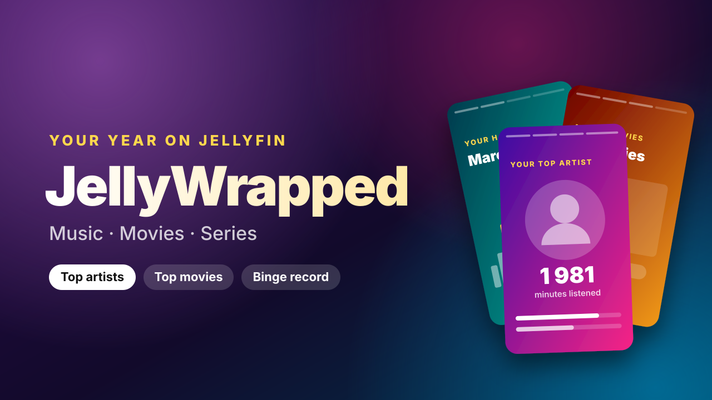

<div align="center">



# JellyWrapped

**Your year on Jellyfin, Wrapped-style.**

A Jellyfin plugin that turns each user's listening and watching history into a yearly recap of their music, movies and series, played as full-screen stories and easy to share.


</div>

## Features

- 🎧 **Accurate tracking.** Records the time actually played, without pauses or skips. Very short plays are ignored (30 s for a track, 2 min for a video by default).
- 📊 **Yearly recap.** Total time, music / movies / series split, top artists, tracks, albums and genres, top movies, actors and favourite decade, top series and binge record, listening habits, server ranking and a persona ("Night owl", "Binge-watcher"…).
- 📤 **Sharing.** A 1080×1920 image generated in the browser, and an optional public link to a frozen snapshot of the recap.
- 🛠️ **Admin view.** A dashboard page showing every user's recap.
- 🕰️ **Past history.**
  - Import from the [Playback Reporting](https://github.com/jellyfin/jellyfin-plugin-playbackreporting) plugin.
  - Estimates based on movies and episodes marked as played.
- ✨ **Built into Jellyfin.** A "My Wrapped" menu entry and a seasonal home-page banner, when [File Transformation](https://github.com/IAmParadox27/jellyfin-plugin-file-transformation) is installed.
- 🌍 **English and French.** JellyWrapped follows each user's Jellyfin display language, then the browser's, and falls back to English.

## Installation

1. Download or [build](#building) the plugin. You need the following files:
   - `Jellyfin.Plugin.JellyWrapped.dll`
   - `meta.json`
   - `jellywrapped.png`
2. Stop Jellyfin.
3. Copy the files into `<jellyfin-data>/plugins/JellyWrapped/`. With the official Docker image, that is `/config/plugins/JellyWrapped/`.
4. Make sure the files belong to the user Jellyfin runs as.
5. Start Jellyfin.

> [!IMPORTANT]
> Restart the Jellyfin process or container (for example `kubectl rollout restart`), not just the "Restart" button of the dashboard: that button restarts inside the same process, so the previous version of the plugin stays loaded.

## Usage

| Who | Where |
| --- | --- |
| Users | `https://<your-server>/JellyWrapped/`. The page reuses the Jellyfin session from the browser. |
| Admins | Dashboard → Plugins → **Users' Wrapped** |
| Settings | Dashboard → Plugins → JellyWrapped |

### Adding a menu entry

The easiest way is to install **File Transformation**. JellyWrapped then adds a "My Wrapped" entry to the side menu and shows a home-page banner during a configurable period (1 December to 31 January by default).

Without it, you can add the link through jellyfin-web's `config.json`:

```json
"menuLinks": [{ "name": "My Wrapped", "icon": "auto_awesome", "url": "/JellyWrapped/" }]
```

> [!NOTE]
> Native clients (Android TV, Swiftfin, Roku…) do not render the web interface, so they cannot show the menu entry or the banner.

## Configuration

| Setting | Default |
| --- | --- |
| Minimum listening time for a track | 30 s |
| Minimum watching time for a video | 120 s |
| Estimate plays from "played" flags | On |
| Compare users across the server (anonymous ranking) | On |
| Allow public share links | On |
| Add the menu entry (requires File Transformation) | On |
| Home banner and its display period | On, 1 Dec → 31 Jan |

## Data & privacy

JellyWrapped stores everything on the server, under `<jellyfin-data>/data/jellywrapped/`:

- `history/<year>.jsonl`: one line per play.
- `shares.json`: the public share links.

Nothing is sent to a third-party service. Share links are opt-in, can be revoked by the user and can be disabled server-wide by the admin.

## Building

Building requires the .NET 10 SDK. A `shell.nix` is provided:

```sh
nix-shell
dotnet build Jellyfin.Plugin.JellyWrapped.slnx -c Release
```

The files to install end up in `Jellyfin.Plugin.JellyWrapped/bin/Release/net10.0/`.

> [!TIP]
> `/JellyWrapped/App/#s=3` opens the recap directly on the fourth slide, which is handy when working on the interface.

### Adding a language

All the texts live in `Jellyfin.Plugin.JellyWrapped/Web/lang-<code>.json`, where `<code>` is a two-letter language code.

1. Copy `lang-en.json` to `lang-<code>.json`.
2. Set `_locale` to the matching locale (for example `de-DE`). It is used to format dates and numbers.
3. Translate the values. Entries written as `{ "one": …, "other": … }` are plural forms; `{n}`, `{name}` and the other placeholders are filled in by the code.
4. Build: every `lang-*.json` file is embedded automatically.

<details>
<summary><b>Project layout</b></summary>

| Folder | Role |
| --- | --- |
| `Tracking/` | Listens to playback events and measures the time played |
| `Data/` | Play history store |
| `Stats/` | Builds the yearly recap |
| `Sharing/` | Public share links |
| `Api/` | REST API and web app hosting |
| `Web/` | Story web app, translations and the script injected into Jellyfin |
| `Configuration/` | Settings and admin dashboard pages |

</details>

<details>
<summary><b>API</b></summary>

| Method | Route | Access |
| --- | --- | --- |
| `GET` | `/JellyWrapped/Years?tz=` | User |
| `GET` | `/JellyWrapped/Report/{year}?tz=` | User |
| `POST` `DELETE` | `/JellyWrapped/Shares/{year}` | User |
| `GET` | `/JellyWrapped/Shared/{token}` | Public |
| `GET` | `/JellyWrapped/Banner` | Public |
| `GET` | `/JellyWrapped/Admin/Users?year=&tz=` | Admin |
| `GET` | `/JellyWrapped/Admin/Report/{userId}/{year}?tz=` | Admin |
| `GET` | `/JellyWrapped/Status` | Admin |
| `POST` | `/JellyWrapped/Import/PlaybackReporting` | Admin |

`tz` is an IANA time zone (for example `Europe/Paris`), used to assign plays to the right day and hour.

</details>

## License

The source code is released under the [MIT License](LICENSE). Based on the [Jellyfin plugin template](https://github.com/jellyfin/jellyfin-plugin-template).

Jellyfin itself is licensed under GPL-2.0, so a compiled build of the plugin, linked against Jellyfin's libraries, is distributed under GPL terms.
